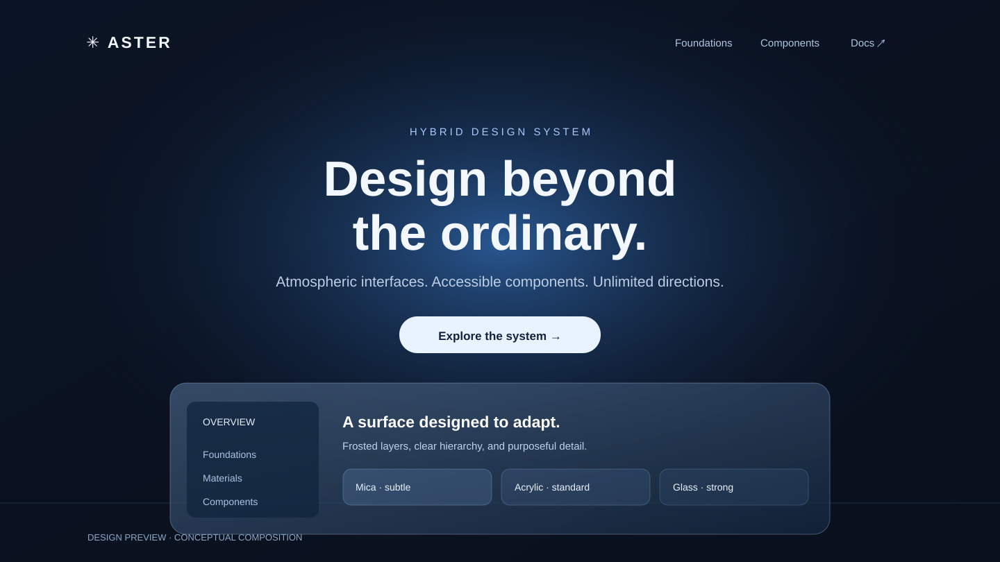
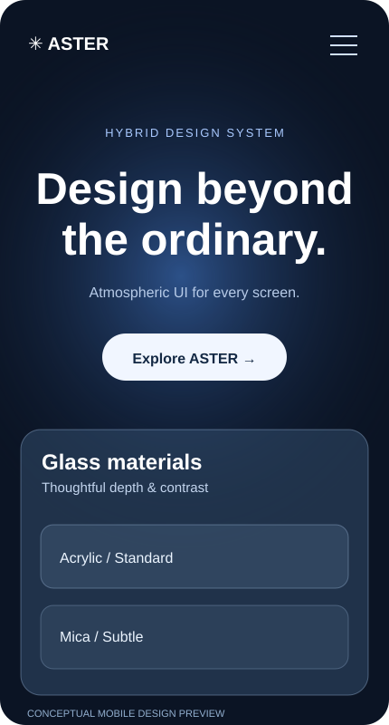

<div align="center">


<br />

**An independent design skill for exceptional landing pages.**

A reusable visual language for AI coding agents: atmospheric compositions, sophisticated glass materials, accessible components, and framework-aware implementation.

[](https://agentskills.io/specification)
[](SKILL.md)
[](LICENSE)
[](references/05-frameworks.md)

[**Get started**](#quick-start) · [**Design language**](#design-language) · [**Documentation**](docs/INDEX.md) · [**Installation guide**](INSTALLATION.md)

</div>

---

## Overview

**ASTER Landing Design** is a portable [Agent Skills](https://agentskills.io/specification) package that helps AI coding agents **create, personalize, refactor, and review** high-quality landing pages.

It does not impose a frontend framework or replace your existing component library. Instead, it provides a documented set of design decisions, semantic tokens, layout recipes, implementation guidance, and quality checks.

| Visual direction | Engineering approach | User experience |
| :--- | :--- | :--- |
| Corporate, restrained brand identity | Framework-agnostic instructions | Accessible interaction patterns |
| Atmospheric gradients and deliberate depth | Reusable semantic design tokens | Responsive page structures |
| Acrylic / Mica-like glass treatments | Preserve existing project architecture | Reduced motion and transparency fallbacks |
| Editorial typography and layouts | Consistent component conventions | Working calls to action and clear navigation |

## Visual identity

The ASTER identity is built around a **refined letter A**: restrained geometry, carefully balanced blue tones, and a professional appearance suited to software products and technical documentation.

<table>
  <tr>
    <td width="50%" align="center">
      
      <br /><strong>Dark signature</strong>
    </td>
    <td width="50%" align="center">
      
      <br /><strong>Light signature</strong>
    </td>
  </tr>
</table>

The wordmark, spacing rules, color direction, and recommended uses are documented in the [**Brand Identity Guidelines**](docs/BRAND-IDENTITY.md).

## Design preview



<table>
  <tr>
    <td width="65%" valign="top"><strong>Desktop / atmospheric composition</strong><br /><br />Editorial hierarchy, balanced negative space, subtle blue illumination, and layered interfaces.</td>
    <td width="35%" align="center"><br /><strong>Mobile / deliberate reflow</strong></td>
  </tr>
</table>

> **About these visuals:** The SVG illustrations above are **conceptual design previews**, not screenshots captured from a running browser. A working dependency-free HTML example is included in [assets/landing-starter.html](assets/landing-starter.html).

## Design language

### 01. Foundations

A consistent system of color, typography, spacing, radii, elevation, and semantic surface roles. The palette is an **ASTER design proposal**, not an exact extraction from another brand.

See [Foundations](references/01-foundations.md).

### 02. Glass materials

Glassmorphism is used selectively—not across every surface.

| Material | Recommended use |
| :--- | :--- |
| **Mica-like** | Persistent shell surfaces, navigation and quiet background areas |
| **Acrylic-like** | Floating panels, overlays, menus and temporary surfaces |
| **Opaque** | Dense data, critical controls, long-form content and fallback states |

Intensity settings are **Subtle (10px)**, **Standard (22px)**, and **Strong (36px)** as starter blur values; tune opacity and contrast for the actual layout. See [Glass Materials](references/03-glass-materials.md).

### 03. Adaptable composition

Use original hero layouts, meaningful calls to action, useful product imagery, and responsive content hierarchy. ASTER is a **design decision system**, not a fixed landing-page template.

See [Layouts](references/02-layouts.md) and [Content & Copy](references/07-content-and-copy.md).

### 04. Accessible components

Components should define visual variants, interaction states, keyboard handling, semantic markup, and light/dark adaptation. The quality checklist includes contrast, reduced motion, and responsive testing.

See [Components](references/04-components.md) and [Quality Checklist](references/06-quality-checklist.md).

## Quick start

### Install using a compatible Agent Skills installer

```bash
npx skills add TersanPlay/ASTER-Landing-Design
```

Support for this command depends on the selected installer and agent. For manual installation:

```bash
git clone https://github.com/TersanPlay/ASTER-Landing-Design.git
```

Then copy the skill into a directory recognized by your agent, or provide [SKILL.md](SKILL.md) with the necessary reference files as custom instructions. Consult [INSTALLATION.md](INSTALLATION.md) for paths and troubleshooting.

### Example agent prompt

> Use `aster-landing-design` to create a responsive, professional landing page for my product. Preserve the existing framework. Apply ASTER foundations, a clear hero and CTA, accessible dark/light theming, restrained Acrylic-like overlays and Mica-like persistent surfaces. Verify responsive behavior and document your changes.

## Working example

The repository includes a small interactive demo with a theme toggle, glass panel, and responsive feature section.

1. Download or clone the repository.
2. Keep `assets/landing-starter.html` and `assets/aster-tokens.css` together.
3. Open `assets/landing-starter.html` in a browser.

This starter demonstrates design tokens; it is not a compiled frontend application or a complete component framework.

## Repository architecture

```text
ASTER-Landing-Design/
├── SKILL.md                  # Agent entry point
├── README.md                 # Project presentation
├── INSTALLATION.md           # Setup instructions
├── LICENSE
├── assets/
│   ├── aster-tokens.css
│   └── landing-starter.html
├── docs/
│   ├── INDEX.md              # Documentation map
│   ├── BRAND-IDENTITY.md     # Corporate identity
│   ├── brand/                # Official vector marks
│   └── images/               # Conceptual visual previews
├── examples/
│   └── prompts.md
├── references/
│   ├── 01-foundations.md
│   ├── 02-layouts.md
│   ├── 03-glass-materials.md
│   ├── 04-components.md
│   ├── 05-frameworks.md
│   ├── 06-quality-checklist.md
│   └── 07-content-and-copy.md
└── scripts/
    └── validate_skill.py
```

## Framework compatibility

ASTER provides guidance for **React, Next.js, Vue, Nuxt, Svelte, SvelteKit, Astro, and semantic HTML/CSS/JavaScript**. Compatibility means its instructions can guide development in these ecosystems; it is **not** a runtime plugin tested in every IDE or framework.

## Validation

Check the required skill structure:

```bash
python scripts/validate_skill.py
```

The script checks package files and entrypoint metadata. It does not replace build tests, browser screenshots, accessibility audits or manual UI review.

## Documentation

For a structured index of every resource, see **[docs/INDEX.md](docs/INDEX.md)**. For installation details and examples, visit [INSTALLATION.md](INSTALLATION.md) and [examples/prompts.md](examples/prompts.md).

---

<div align="center">

**ASTER Landing Design**

*Professional by default. Flexible by design. Clear in execution.*

[Skill](SKILL.md) · [Installation](INSTALLATION.md) · [Brand](docs/BRAND-IDENTITY.md) · [MIT License](LICENSE)

</div>
